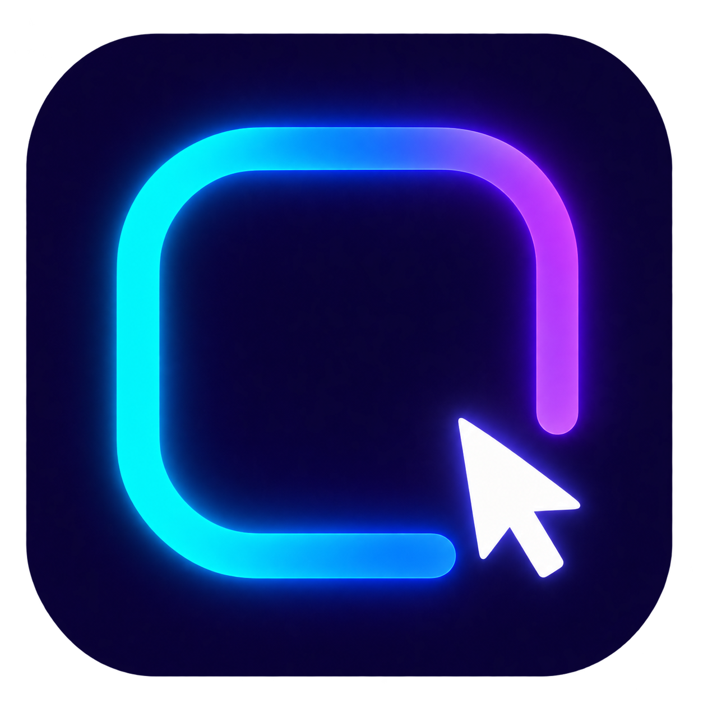

# Halo Studio — bêta



Application Windows de lumière ambiante : un halo qui suit les couleurs des applications et des vidéos, avec huit styles de pointeur lumineux. Les pointeurs main et texte suivent aussi le thème choisi.

## Installer

Télécharger **HaloStudio-Setup-1.0.0-beta.3.exe** depuis les [versions publiées](https://github.com/hassan312-god/halo-studio/releases), puis ouvrir l’installateur. Installation pour le compte courant, raccourci dans le menu Démarrer et raccourci bureau facultatif. Pas de droits administrateur requis.

L’aperçu à droite montre une capture locale en direct de l’écran actif. Le halo est plus visible sur les pages claires, les changements de couleur sont lissés et un reflet glisse doucement sur les bords. Le mode « vidéo uniquement » active le halo lorsqu’un contenu animé coloré est détecté. La luminosité matérielle du PC est réglable si Windows expose cette fonction.

Windows 10 version 2004 ou ultérieure / Windows 11, .NET Framework 4.8 (fourni avec ces versions de Windows). PC portable ou de bureau, un ou plusieurs écrans.

Cette bêta n’est pas signée avec un certificat Authenticode. Windows peut donc afficher un avertissement d’éditeur inconnu. Le SHA-256 de l’installateur est publié avec chaque version.

## Réglages

- **Couleurs** : teinte unique au choix ou synchronisation avec le contenu affiché.
- **Souris** : pointe douce, flèche classique, flèche fine, diamant ou croix précise ; taille et intensité réglables. La lueur appartient au curseur natif et suit ses contours sans couche circulaire séparée.
- **Écran** : intensité et étendue du halo, amplification vidéo et luminosité matérielle lorsque l’écran la prend en charge.
- **Aperçu à droite** : petit écran clair ou sombre mis à jour pendant les réglages ; la représentation de luminosité physique reste indicative.
- **Mises à jour** : vérification au lancement puis toutes les six heures, téléchargement des versions publiées plus récentes, contrôle SHA-256 avant installation. Les mises à jour automatiques s’appliquent à la fermeture ; un bouton permet d’installer et relancer immédiatement.

`Ctrl + Alt + Maj + H` : pause/reprise. `Ctrl + Alt + Maj + Q` : quitter. Le pointeur d’origine est restauré à l’arrêt ; un processus de secours le restaure en cas de fermeture brutale.

## Données et limites

L’analyse des couleurs est locale : aucune image d’écran n’est enregistrée ou envoyée. Les seules connexions réseau de l’application concernent les mises à jour sur GitHub. Les préférences sont conservées dans `%LOCALAPPDATA%\HaloStudio\reglages.xml`, séparément des fichiers installés. La désinstallation les conserve.

Les vidéos protégées, certains jeux en plein écran exclusif et l’écran de verrouillage peuvent bloquer la capture ou les effets. La luminosité matérielle dépend du pilote et de l’écran. Les curseurs de saisie et de redimensionnement conservent leur fonction Windows. La détection visuelle des vidéos peut aussi réagir à un défilement très coloré.

## Compiler et publier

Sur Windows avec .NET Framework 4.8 :

```powershell
.\Compiler.ps1
.\Build-Installer.ps1
.\Halo.exe --self-test "C:\chemin\vers\resultats"
```

Les binaires sont produits dans `build/`. Pour une nouvelle bêta, mettre à jour `BuildInfo.cs` et les métadonnées dans `AssemblyInfo.cs`, compiler, tester, créer un tag `v1.0.0-beta.N` puis une préversion GitHub avec `HaloStudio-Setup-1.0.0-beta.N.exe` et son fichier `.sha256`. L’application lit les préversions et les versions stables, ignore les brouillons et refuse les versions antérieures ou les empreintes absentes.

Le code est public. Aucun secret GitHub ni fichier personnel n’est inclus dans le logiciel.
